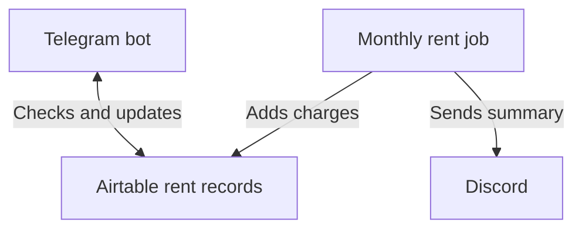

# rent-workers

Two Cloudflare Workers help a property manager track rent. On the 15th of each month, one creates next month’s rent charges in Airtable and sends a summary to Discord. The other runs a Telegram bot for checking what’s owed, recording payments, and managing tenancies.

## Using the Telegram bot

| To do this | Use |
|---|---|
| See overdue charges and those due in the next 14 days | `/reminder` |
| Record a payment against a charge | `/pay` |
| Move a tenant in and record their first rent and optional bond | `/movein` |
| Set a tenant’s move-out date | `/moveout` |
| Show commands or cancel the current task | `/help` or `/cancel` |

For example, if December rent is due on the 5th, the November 15 run creates the charge. On December 1, use `/reminder` to see it. When the tenant pays, use `/pay` to record the payment.

## Working on the repo

Use Node.js 22. From the repo root, run `npm ci` to install dependencies. Run `npm run typecheck`, `npm run lint`, `npm test`, and `npm run build` to check your changes.

- Worker setup and local development: [Monthly rent job](./charge-generator/README.md) · [Telegram bot](./payment-worker/README.md)
- Shared code: [Rent and tenancy rules](./packages/tenancy/) · [Airtable client](./packages/airtable-client/)
- Deployment and troubleshooting: [Staging](./docs/staging-cicd.md) · [Production](./docs/production-cicd.md) · [Runbook](./docs/runbook.md)
