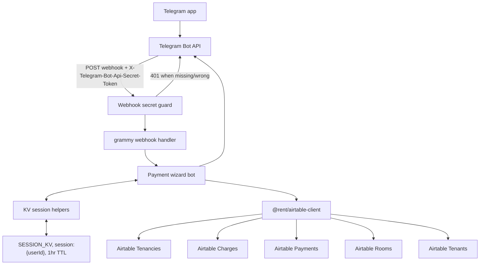

# payment-bot

Cloudflare Worker running a single-operator Telegram bot for recording tenant rent payments, moving tenants in, and moving tenants out in Airtable.

## Architecture



### Technology choices

| Layer | Technology | Why |
|---|---|---|
| Runtime | Cloudflare Workers | Stateless HTTPS endpoint for Telegram webhooks |
| Bot framework | grammy | First-class Cloudflare Workers webhook support |
| Session storage | Cloudflare KV | Wizard state survives between webhook requests and expires automatically |
| Tenancy rules | `@rent/tenancy` | Pure due-date, charge, start-date and end-date rules shared with `charge-generator` |
| Airtable I/O | `@rent/airtable-client` | Shared table IDs, Zod schemas, pagination, retries, and timeouts |
| Auth | `AUTHORIZED_USER_ID` plus `TELEGRAM_WEBHOOK_SECRET` | The bot is single-operator, and Telegram webhook POSTs must carry the configured secret token |

## What It Does

The bot guides the authorized user through a 6-step wizard to log a payment against an outstanding charge. Session state persists in Cloudflare KV with a 1-hour TTL. The final Payment record is created in Airtable and the bot replies with a direct Airtable link.

The bot also supports a read-only `/reminder` command that lists overdue charges under "Pay now" and charges due from today through the next 14 days under "Due in next 14 days". A tenant can appear in both sections, and every outstanding charge is listed separately so multi-month debt is visible. Reminder tenant groups are shown by earliest due date, with each tenant's charge rows also sorted by due date.

The bot also has two flows for tenant changes. `/movein` creates a tenancy and `/moveout` ends one. Both are described below.

### Wizard Flow

```text
/pay
  -> Step 1: Select tenant        inline keyboard, shows balance per tenancy; lists active tenancies plus ended ones that still owe
  -> Step 2: Select charge        inline keyboard, shows outstanding amount/status
  -> Step 3: Enter amount         text reply, accepts 1650, $1,650, 1650.00
  -> Step 4: Select method        Cash | Bank Transfer
  -> Step 5: Select date          Today | Yesterday (Melbourne dates) | manual date
  -> Step 6: Confirm              summary with Confirm / Cancel buttons
  -> Payment record created in Airtable
```

### Move-Out Flow

```text
/moveout
  -> Select tenancy   inline keyboard; lists tenancies with no End Date or an End Date after Airtable's TODAY(), with balance
  -> Select end date  Today | End of this month | manual date (YYYY-MM-DD or DD/MM/YYYY); not before the Start Date
  -> Confirm          shows owed-through-end-date, the room change, and charges due after the end date
  -> Tenancy End Date is set; the room is set to Vacant when the end date is today or earlier
```

The confirm screen reads that tenancy's charges once. It warns about every charge due after the end date, with its status and a link, because the tenancy no longer owes them. The bot does not change those charges. Fix them by hand in Airtable.

The room is set to `Vacant` only when the end date is today (Melbourne) or earlier. For a later end date the room stays `Occupied`, and the reply says to set it to Vacant in Airtable after the tenant leaves.

After a successful move-out the reply offers a "Start new tenant in {room}" button that starts `/movein` with that room already chosen.

If the tenancy update fails with a 4xx, nothing changed. If it fails with a 5xx or a timeout, it may have saved, and the reply links to the tenancy to check. If only the room update fails, the reply says the end date saved and asks you to set the room to Vacant.

### Move-In Flow

```text
/movein
  -> Select room       inline keyboard; vacant rooms first, each showing its Status (the handover button from /moveout skips this)
  -> Tenant name       text reply; an existing tenant with the same Name can be reused
  -> Notes             new tenants only; text reply or Skip
  -> Monthly rent      Rooms "Default Rent" button, or a typed amount
  -> Start date        Today | 1st of next month | manual date; not more than 60 days in the past
  -> First payment     Regular monthly from start date | Part month, then monthly on the 1st
  -> (part month only) amount: suggested rent x 12 / 365 per day, or typed
  -> Confirm           shows the tenancy, due day, and every charge to create
  -> Tenant, Tenancy, Charges, then Room are written
```

First-payment options:

| Option | First charge | Due day |
|---|---|---|
| Regular monthly from start date | Full monthly rent, due on the start date | The start day, capped at 28 |
| Part month, then monthly on the 1st | A prorated amount for the rest of the start month, due on the start date | 1 |

The part-month option is not offered when the start date is already the 1st.

Charges created: the first charge for the start month, plus one regular charge for each later month the charge generator has already covered. The generator runs on the 15th (UTC), so if the bot runs on or after the 15th (UTC) it also creates next month's charge. Otherwise the generator creates it later.

The confirm screen warns when the room is currently `Occupied`. The tenancy label is `{Room code} {Tenant name}`.

Writes happen in this order, with no rollback: Tenants (when new), Tenancies, Charges (one per charge), Rooms `Status` set to `Occupied`. If a step fails, the reply lists the finished steps with links and the steps still to do. A 4xx means that step did not save. A 5xx, timeout or unreadable response means it may have saved, and the reply says to check that table before redoing it.

Confirm for both flows sets the KV session step to `saving` before writing. A second tap on Confirm or Cancel finds `saving` and writes nothing. It replies that the save is already in progress or has finished, and says to check Airtable before trying again.

The Airtable client in this Worker uses a 5 second timeout per request (`src/airtable.ts`). The grammY webhook handler waits up to 50 seconds (`src/index.ts`), so a slow Airtable cannot cut off a Confirm partway through. grammY's own default is 10 seconds.

## Airtable Schema

| Table | ID |
|---|---|
| Tenancies | `tblvVmo12VikITRH6` |
| Charges | `tblNCw6ZxspNxiKCu` |
| Payments | `tbl8Zl9C9fzBDPllu` |
| Tenants | `tblsesIqj1VuokNcP` |
| Rooms | `tblBrzawaTuwahBQg` |

The Worker uses `@rent/airtable-client` schemas:

| Schema | Used for |
|---|---|
| `TenancySchema` | Reading `Label`, `Balance`, `Start Date`, `End Date`, `Room`; creating tenancies; updating `End Date` |
| `ChargeSchema` | Reading `Label`, `Balance`, `Status`, `Due Date`, `Tenancy`, `Type` |
| `PaymentSchema` | Validating Payment create responses |
| `TenantSchema` | Looking up a tenant by `Name`; creating tenants with `Name` and `Notes` |
| `RoomSchema` | Reading `Code`, `Default Rent`, `Status`; updating `Status` |

Outstanding charges may have Airtable `Status` values `Due`, `Unpaid`, `Partial`, or `Overdue`; `Paid` charges are filtered out before the wizard shows charge choices.

Payment fields written:

| Field | Value |
|---|---|
| `Label` | `{tenant name} {YYYY-MM-DD} ${amount}` |
| `Charge` | linked charge record ID |
| `Amount` | entered amount |
| `Paid Date` | selected date |
| `Method` | `Cash` or `Bank Transfer` |
| `Notes` | `Recorded via payment-bot on {datetime}` |

Fields written by `/movein` and `/moveout`:

| Table | Fields |
|---|---|
| Tenants | `Name`, `Notes` (only for a new tenant) |
| Tenancies (create) | `Label`, `Room`, `Tenant`, `Start Date`, `Due Day`, `Monthly Rent`, `Frequency` = `Monthly` |
| Tenancies (move-out) | `End Date` |
| Charges | Built by `buildRentCharge` in `@rent/tenancy`: `Label`, `Tenancy`, `Type` = `Rent`, `Period`, `Due Date`, `Amount` |
| Rooms | `Status` = `Occupied` (move-in) or `Vacant` (move-out) |

Free Airtable plans allow a limited number of API calls per month. A move-in costs about 5 to 7 calls and a move-out about 4.

## Environment

### Secrets

Set with `npx wrangler secret put <NAME>` from `payment-worker/`.

| Name | Description |
|---|---|
| `TELEGRAM_BOT_TOKEN` | From @BotFather |
| `TELEGRAM_WEBHOOK_SECRET` | High-entropy secret, at least 16 chars; use `openssl rand -hex 32` |
| `AIRTABLE_TOKEN` | PAT with `data.records:read` and `data.records:write` |
| `AUTHORIZED_USER_ID` | Telegram numeric user ID for the single authorized operator |

### Vars

| Name | Value |
|---|---|
| `AIRTABLE_BASE_ID` | `app6He8xRaUzNBTDl` |

### KV Namespace

| Binding | Purpose |
|---|---|
| `SESSION_KV` | Wizard session state, 1hr TTL per user |

## Setup

### 1. Create KV Namespace

```bash
npx wrangler kv namespace create SESSION_KV
```

Copy the returned `id` into `wrangler.toml` under `[[kv_namespaces]]`.

### 2. Set Secrets

```bash
npx wrangler secret put TELEGRAM_BOT_TOKEN
npx wrangler secret put TELEGRAM_WEBHOOK_SECRET
npx wrangler secret put AIRTABLE_TOKEN
npx wrangler secret put AUTHORIZED_USER_ID
```

### 3. Deploy

```bash
npm install
npm run deploy
```

Note the Worker URL, for example `https://payment-bot.<your-subdomain>.workers.dev`.

### 4. Register Telegram Webhook

Run once after deploy, and again whenever `TELEGRAM_WEBHOOK_SECRET` is rotated:

```bash
curl "https://api.telegram.org/bot<YOUR_BOT_TOKEN>/setWebhook" \
  -d "url=https://payment-bot.<your-subdomain>.workers.dev" \
  -d "secret_token=<TELEGRAM_WEBHOOK_SECRET>"
```

Telegram should return:

```json
{"ok":true,"result":true,"description":"Webhook was set"}
```

Telegram then sends `X-Telegram-Bot-Api-Secret-Token: <TELEGRAM_WEBHOOK_SECRET>` on every webhook POST. The Worker rejects POSTs without the matching header.

Verify registration:

```bash
curl "https://api.telegram.org/bot<YOUR_BOT_TOKEN>/getWebhookInfo"
```

### 5. Smoke Test

Open Telegram, find the bot, and send `/help`.

## Commands

| Bot command | Action |
|---|---|
| `/pay` | Start payment wizard |
| `/reminder` | Show overdue payments and payments due in the next 14 days |
| `/movein` | Move a tenant into a room: creates the Tenant, Tenancy and first Charges, and sets the room to Occupied |
| `/moveout` | End a tenancy: sets the tenancy End Date, and sets the room to Vacant when the end date is today or earlier |
| `/cancel` | Cancel any flow from any step |
| `/help` or `/start` | Show command list |

## Development Commands

| Command | Purpose |
|---|---|
| `npm run dev` | Local dev with Wrangler |
| `npm run deploy` | Deploy to Cloudflare |
| `npm run deploy -- --env=""` | Deploy production explicitly |
| `npm run deploy -- --env staging` | Deploy `payment-bot-staging` |
| `npm run types` | Regenerate Worker binding types |
| `npm run typecheck` | Type-check this worker |
| `npm run build` | Wrangler deploy dry-run |
| `npm run build -- --env=""` | Wrangler deploy dry-run against production config explicitly |
| `npm run build -- --env staging` | Wrangler deploy dry-run against staging config |

From the repo root:

```bash
npm run typecheck
npm run test -- payment-worker
npm run build
```

## Testing

Test coverage includes:

| Layer | Files | Coverage |
|---|---|---|
| Unit | `test/format.test.ts` | amount/date parsing, Melbourne dates, HTTP status extraction, and AUD formatting |
| Unit | `test/outstanding.test.ts` | charge-level reminder filtering, bucket totals, tenant grouping, and `/pay` charge selection |
| Unit | `test/reminder.test.ts` | concise Telegram reminder formatting, Markdown escaping, and message splitting |
| Unit | `test/session.test.ts` | KV session get/set/clear and TTL |
| Unit | `test/auth.test.ts` | webhook secret fail-closed behavior |
| Unit | `test/timeouts.test.ts` | the 50 second webhook timeout and the 5 second Airtable request timeout |
| Integration | `test/integration/reminder.test.ts` | `/reminder` output, authorization, and session non-mutation |
| Integration | `test/integration/webhook.test.ts` | GET banner and webhook secret rejection |
| Integration | `test/integration/wizard.test.ts` | full wizard path, invalid amount, cancel, and Payment payload |
| Integration | `test/integration/moveout.test.ts` | `/moveout` end dates, charges-after-end-date warning, room Vacant rule, stale and double confirm, and partial-failure replies |
| Integration | `test/integration/movein.test.ts` | `/movein` new and existing tenants, first-payment options, written payloads, occupied-room warning, handover from `/moveout`, and partial-failure replies |
| Helper | `test/integration/helpers.ts` | shared Telegram update builders, Airtable and Telegram mocks, and table IDs for the integration tests |

Run from the repo root:

```bash
npm run test
npm run test -- payment-worker
```

Integration tests run inside `@cloudflare/vitest-pool-workers` with Telegram and Airtable HTTP calls mocked. Tests must not hit the real Airtable API.

## Staging

The `staging` Wrangler environment deploys as `payment-bot-staging`.

Staging config:

| Binding / var | Value |
|---|---|
| `AIRTABLE_BASE_ID` | `appzRYFa1yW5pQDEW` |
| `SESSION_KV` | `17e24003884e454dbd96d81acc37bf2d` |
| Telegram bot | `@ChwqueudciBot` |

Staging secrets are set separately:

```bash
npx wrangler secret put TELEGRAM_BOT_TOKEN --env staging
npx wrangler secret put TELEGRAM_WEBHOOK_SECRET --env staging
npx wrangler secret put AIRTABLE_TOKEN --env staging
npx wrangler secret put AUTHORIZED_USER_ID --env staging
```

The staging deploy workflow registers the Telegram webhook automatically after deployment.

## File Layout

```text
src/
  index.ts      -- Worker entrypoint, GET banner, Telegram secret guard, webhook handler and its timeout
  airtable.ts   -- the Airtable client the bot uses, with its request timeout
  bot.ts        -- grammy bot commands, callbacks, and /pay wizard steps
  movein.ts     -- /movein flow: room, tenant, rent, start date, confirm, and the ordered writes
  movein-view.ts -- /movein prompts, confirm text, and partial-failure reply text
  moveout.ts    -- /moveout flow: tenancy, end date, confirm, and the tenancy and room updates
  outstanding.ts -- outstanding charge filtering, grouping, and reminder bucket rules
  reminder.ts    -- Telegram Markdown reminder formatting and message splitting
  format.ts     -- amount/date parsing, Melbourne dates, HTTP status extraction, and display formatting
  session.ts    -- KV session helpers
  auth.ts       -- Telegram webhook secret guard
  types.ts      -- Env, WizardSession and flow step types
test/
  auth.test.ts
  format.test.ts
  session.test.ts
  timeouts.test.ts
  integration/
    webhook.test.ts
    reminder.test.ts
    wizard.test.ts
    moveout.test.ts
    movein.test.ts
    helpers.ts
vitest.config.ts
vitest.integration.config.ts
wrangler.toml
tsconfig.json
```

`payment-worker/src/airtable.ts` has been removed; Airtable I/O belongs in `@rent/airtable-client`.

## Operational Notes

- Non-POST requests return a lightweight "payment-bot is running" banner.
- `GET /health` returns `{"ok":true,"service":"payment-bot"}` for non-mutating smoke tests.
- POST requests fail closed with `401` when `TELEGRAM_WEBHOOK_SECRET` is missing, shorter than 16 characters, or does not match Telegram's header.
- grammy user authorization still happens inside the bot and rejects Telegram users whose ID does not match `AUTHORIZED_USER_ID`.
- Sessions use the `session:{userId}` KV key and a 3600 second TTL.
- Client-side charge filtering by tenancy ID remains intentional because Airtable formula filters on linked-record display values are fragile.
- `/movein` and `/moveout` write to Airtable only after Confirm. Error replies show the HTTP status and never include Airtable response bodies.
- Logs never include Airtable response bodies either. Every bot command logs a failed Airtable call as `[payment-bot] <flow> failed: <action>: <status>`, for example `[payment-bot] pay failed: create Payments: HTTP 422`. The `/pay` "Failed to save payment" reply shows only the status.
- `/pay` lists active tenancies plus ended tenancies that still have a positive `Balance`.
- Wizard dates (`Today`, `Yesterday`, end-date buttons), the move-in start-date check and the move-out Vacant decision use Melbourne time. The `/moveout` and `/pay` tenancy lists are filtered by Airtable's `TODAY()` in the filter formula, not by the Melbourne date. The move-in rule for next month's charge uses the UTC date, to match the charge generator's cron.
- `/reminder` is read-only: it does not create Payment records and does not mutate the wizard session.
- `/reminder` lists every outstanding charge, not one row per tenant, so tenants more than one month behind show every unpaid month.
- `/reminder` sorts tenant groups by the earliest due date in the group, then sorts that tenant's rows by due date.
- Reminder output has two buckets: overdue charges under "Pay now" and charges due from today through the next 14 days under "Due in next 14 days".
